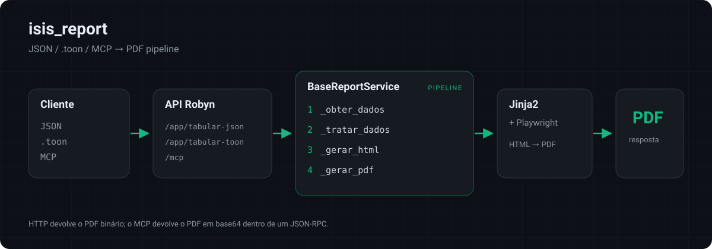

# Isis Report

Microserviço **assíncrono** para geração de relatórios em PDF com layouts hierárquicos customizáveis, construído com [Robyn](https://robyn.tech).

Aceita payloads em **JSON** ou no formato textual **`.toon`** e produz PDFs prontos para impressão via Playwright.

## Arquitetura

```
app/
├── api/               # Inicialização do Robyn + OpenAPI/Swagger
├── modules/
│   ├── status/        # Healthcheck da aplicação
│   ├── tabular_json/  # POST /app/tabular-json  (entrada JSON)
│   └── tabular_toon/  # POST /app/tabular-toon  (entrada .toon)
├── templates/         # Templates Jinja2
├── extensions/        # Jinja, Playwright pool, logger
├── utils/             # Layout converter, parser .toon
└── run.py             # Entry point
```

Cada módulo segue o pipeline definido em `BaseReportService`:
`_obter_dados → _tratar_dados → _gerar_html → _gerar_pdf`



## Setup

```bash
git clone <repo>
cd isis_report

# Instala dependências e Playwright
./dev/dependencies.sh

# Inicia o servidor
python app/run.py
```

O servidor sobe em `http://localhost:5000`. O Swagger UI fica em `/docs` e o schema OpenAPI em `/openapi.json`.

## API

### `POST /app/tabular-json`

Gera relatório a partir de um payload JSON com `meta`, `layout` (opcional) e `data`.

**Exemplo completo:**

```bash
curl -X POST http://localhost:5000/app/tabular-json \
  -H "Content-Type: application/json" \
  -d '{
    "meta": {
      "title": "Pedido de Vendas",
      "sub_title": "De 01/01/2024 até 31/12/2024",
      "mode": "exact"
    },
    "layout": {
      "empresa": { "label": "Empresa", "format_mask": "str", "alignment": "left" },
      "data_entrega": { "label": "Data Entrega", "format_mask": "date", "alignment": "center" },
      "pedidos": {
        "pedido": { "label": "Código", "format_mask": "int", "alignment": "right" },
        "data_pedido": { "label": "Data Pedido", "format_mask": "date", "alignment": "center" },
        "nome_produto": { "label": "Produto", "format_mask": "str", "alignment": "left" },
        "total_tarifa": { "label": "Total Tarifa", "format_mask": "float", "alignment": "right" },
        "valor_total": { "label": "Valor Total", "format_mask": "float", "alignment": "right" },
        "cargas": {
          "qtde": { "label": "Quantidade", "format_mask": "int", "alignment": "right" },
          "valor_unitario": { "label": "Valor Unitário", "format_mask": "float", "alignment": "right" },
          "valor_total": { "label": "Valor Total", "format_mask": "float", "alignment": "right" }
        }
      }
    },
    "data": [
      {
        "empresa": "CQ CONSULTORIA ADMINITRATIVA",
        "data_entrega": "01/12/2024",
        "pedidos": [
          {
            "pedido": 750,
            "data_pedido": "01/12/2024",
            "nome_produto": "CQ REFEIÇÃO",
            "total_tarifa": 9.01,
            "valor_total": 4000,
            "cargas": [
              { "qtde": 1, "valor_unitario": 1500, "valor_total": 1500 },
              { "qtde": 1, "valor_unitario": 1000, "valor_total": 1000 },
              { "qtde": 1, "valor_unitario": 1500, "valor_total": 1500 }
            ]
          },
          {
            "pedido": 8750,
            "data_pedido": "01/12/2024",
            "nome_produto": "CQ REFEIÇÃO",
            "total_tarifa": 9.01,
            "valor_total": 4000,
            "cargas": [
              { "qtde": 1, "valor_unitario": 1500, "valor_total": 1500 },
              { "qtde": 1, "valor_unitario": 1000, "valor_total": 1000 },
              { "qtde": 1, "valor_unitario": 1500, "valor_total": 1500 }
            ]
          }
        ]
      }
    ]
  }' \
  -o relatorio.pdf
```

| Campo | Tipo | Obrigatório | Descrição |
|-------|------|-------------|-----------|
| `meta` | object | sim | `title`, `sub_title` e `mode` (`"exact"` ou `"gray"`) |
| `layout` | object | não | Definição hierárquica dos campos (omitir para inferir dos dados) |
| `data` | array | sim | Registros com `fields` e aninhamento opcional via `groups` |

---

### `POST /app/tabular-toon`

Gera relatório a partir de texto no formato `.toon` — uma notação indentada compacta que descreve o mesmo payload do JSON.

**Exemplo `.toon` (sintaxe compacta de layout):**

```toon
meta:
  company: Minha Empresa
  title: Pedido de Vendas
  sub_title: De 01/01/2024 até 31/12/2024
  type: pdf
  mode: exact
layout:
  empresa{Empresa,str,left}
  data_entrega{Data Entrega,date,center}
  pedidos:
    pedido{Código,int,right}
    data_pedido{Data Pedido,date,center}
    nome_produto{Produto,str,left}
    total_tarifa{Total Tarifa,float,right}
    valor_total{Valor Total,float,right}
    cargas:
      qtde{Quantidade,int,right}
      valor_unitario{Valor Unitário,float,right}
      valor_total{Valor Total,float,right}
dados[1]:
  - empresa: CQ CONSULTORIA ADMINITRATIVA
    data_entrega: 01/12/2024
    pedidos[2]:
      - pedido: 750
        data_pedido: 01/12/2024
        nome_produto: CQ REFEIÇÃO
        total_tarifa: 9.01
        valor_total: 4000
        cargas[3]{qtde,valor_unitario,valor_total}:
          1,1500,1500
          1,1000,1000
          1,1500,1500
      - pedido: 8750
        data_pedido: 01/12/2024
        nome_produto: CQ REFEIÇÃO
        total_tarifa: 9.01
        valor_total: 4000
        cargas[3]{qtde,valor_unitario,valor_total}:
          1,1500,1500
          1,1000,1000
          1,1500,1500
```

**Uso:**

```bash
curl -X POST http://localhost:5000/app/tabular-toon \
  -H "Content-Type: text/plain" \
  -d @pedido.toon \
  -o relatorio.pdf
```

### Sintaxe `.toon`

| Padrão | Descrição |
|--------|-----------|
| `chave: valor` | Par chave-valor simples |
| `chave:` + linhas indentadas | Objeto aninhado |
| `chave[n]:` + itens `- ...` | Array com `n` elementos |
| `chave[n]{a,b}:` + `v1,v2` | Array de objetos com campos `a`, `b` |
| `dados[n]:` | Mapeado automaticamente para `data` |
| `chave{Label,formato,align}` | Campo de layout inline (compacto) |

---

### `GET /app/status`

Healthcheck da aplicação.

```bash
curl http://localhost:5000/app/status
```

**Resposta:**

```json
{ "status": "healthy", "uptime": 123.45 }
```

## MCP (Model Context Protocol)

O Robyn expõe nativamente um servidor MCP em `POST /mcp` (JSON-RPC 2.0), permitindo que assistentes de IA like Claude Desktop consumam as tools de geração de relatórios diretamente.

### Tools disponíveis

| Tool | Descrição | Inputs |
|------|-----------|--------|
| `gerar_relatorio_json` | Gera PDF via payload JSON | `meta`, `data`, `layout` (opt) |
| `gerar_relatorio_toon` | Gera PDF via texto `.toon` | `conteudo_toon` |

### Consumo via JSON-RPC (curl)

**Listar tools disponíveis:**

```bash
curl -X POST http://localhost:5000/mcp \
  -H "Content-Type: application/json" \
  -d '{
    "jsonrpc": "2.0",
    "id": 1,
    "method": "tools/list",
    "params": {}
  }'
```

**Chamar `gerar_relatorio_json`:**

```bash
curl -X POST http://localhost:5000/mcp \
  -H "Content-Type: application/json" \
  -d '{
    "jsonrpc": "2.0",
    "id": 2,
    "method": "tools/call",
    "params": {
      "name": "gerar_relatorio_json",
      "arguments": {
        "meta": {
          "title": "Pedido de Vendas",
          "sub_title": "De 01/01/2024 até 31/12/2024",
          "mode": "exact"
        },
        "layout": {
          "empresa": {"label": "Empresa", "format_mask": "str", "alignment": "left"},
          "pedidos": {
            "pedido": {"label": "Código", "format_mask": "int", "alignment": "right"},
            "valor_total": {"label": "Valor Total", "format_mask": "float", "alignment": "right"}
          }
        },
        "data": [
          {
            "empresa": "CQ CONSULTORIA",
            "pedidos": [
              {
                "pedido": 750,
                "valor_total": 4000
              }
            ]
          }
        ]
      }
    }
  }'
```

**Resposta:**

```json
{
  "jsonrpc": "2.0",
  "id": 2,
  "result": {
    "content": [
      {
        "type": "text",
        "text": "{\"pdf_base64\": \"JVBERi0xLjQK...\", \"size_bytes\": 12345}"
      }
    ]
  }
}
```

O PDF vem codificado em base64 no campo `pdf_base64`.

**Chamar `gerar_relatorio_toon`:**

```bash
curl -X POST http://localhost:5000/mcp \
  -H "Content-Type: application/json" \
  -d '{
    "jsonrpc": "2.0",
    "id": 3,
    "method": "tools/call",
    "params": {
      "name": "gerar_relatorio_toon",
      "arguments": {
        "conteudo_toon": "meta:\n  title: Pedido\n  mode: exact\nlayout:\n  produto{Produto,str,left}\n  valor{Valor,float,right}\ndados[1]:\n  - produto: Caneta\n    valor: 5.50"
      }
    }
  }'
```

### Configuração no Claude Desktop

Adicione ao `claude_desktop_config.json`:

```json
{
  "mcpServers": {
    "isis-report": {
      "url": "http://localhost:5000/mcp"
    }
  }
}
```

Após conectar, o Claude terá acesso às tools `gerar_relatorio_json` e `gerar_relatorio_toon` com exemplos completos de payload.

## Respostas

| Status | Content-Type | Body |
|--------|-------------|------|
| `200` | `application/pdf` | PDF binário |
| `200` (MCP) | `application/json` | `{"result": {"content": [{"type": "text", "text": "..."}]}}` |
| `500` | `application/json` | `{"error": "mensagem"}` |

## Desenvolvimento

```bash
# Linter
ruff check . --fix
```

## Licença

Distribuído sob a licença MIT. Veja [LICENSE](LICENSE).
